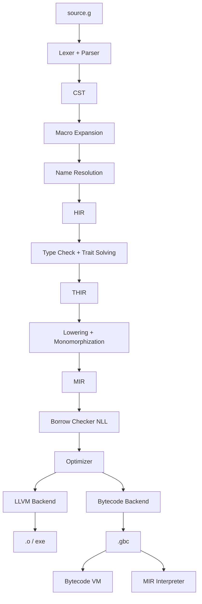

<div align="center">
  <picture>
    <source media="(prefers-color-scheme: dark)" srcset="docs/branding/svg/logo-wordmark-dark.svg?v=2"/>
    
  </picture>

  <p><strong>A real compiler for a Rust-like systems language</strong> — full type inference, NLL borrow checking, and dual LLVM/bytecode backends across 39 modular crates.</p>

  <p>Most compiler side-projects stop at a parser or a tree-walking interpreter. Glyim implements the full pipeline — lexing, parsing, type inference, trait solving, NLL borrow checking, monomorphization, MIR optimization, and two code generation backends. Every stage is a self-contained crate with a narrow, trait-based public API.</p>

  <p>
    
    
    
    
    
    
    
  </p>

  <p>
    <a href="#why-glyim">Why</a> •
    <a href="#language-tour">Tour</a> •
    <a href="#getting-started">Quickstart</a> •
    <a href="#features">Features</a> •
    <a href="#architecture">Architecture</a> •
    <a href="#project-status">Status</a>
  </p>
</div>

---

## Why Glyim

Most compiler side-projects stop at a parser or a tree-walking interpreter. Glyim is built as a _real_ compiler: a complete pipeline from source through type inference, trait solving, NLL borrow checking, monomorphization, MIR optimization, and two code generation backends — LLVM via `inkwell`, and a custom stack-machine bytecode VM.

The architecture is heavily inspired by rustc (arena-allocated IRs, interned types, query-style contexts, trait-based dependency injection), but written from scratch with a strong emphasis on readable code and testability.

---

## Language Tour

```glyim
trait Area {
    fn area(&self) -> f64;
}

enum Shape {
    Circle(f64),
    Rectangle(f64, f64),
    Point,
}

impl Area for Shape {
    fn area(&self) -> f64 {
        match self {
            Shape::Circle(r) => 3.14159 * r * r,
            Shape::Rectangle(w, h) => w * h,
            Shape::Point => 0.0,
        }
    }
}

fn classify(n: i32) -> &str {
    match n {
        0 => "zero",
        1 | 2 => "small",
        x if x < 0 => "negative",
        _ => "large",
    }
}

async fn fetch_twice() -> i32 {
    let a = fetch_one().await;
    let b = fetch_one().await;
    a + b
}
```

> [!NOTE]
> 
>
> The full grammar and standard library are still evolving. `glyim-lang-core`, `glyim-lang-alloc`, and `glyim-lang-std` contain the current stdlib source (written in Glyim) and serve as the compiler's bootstrapping corpus.
>
> <br clear="left" />

---

## Getting Started

### Prerequisites

- **Rust** — latest stable, 2024 edition (Rust 1.95+ recommended; MSRV pinned in `Cargo.toml`)
- **LLVM 23** — a hard workspace dependency (no feature flag)
- **`watchexec`** — optional, for the `justfile` recipes

> [!IMPORTANT]
> 
>
> The LLVM backend is a hard dependency — there is no feature flag to build without it. Install LLVM 23 and set `LLVM_SYS_231_PREFIX` before building (Homebrew: `$(brew --prefix llvm@23)`, Debian/Ubuntu: `/usr/lib/llvm-23`).
>
> <br clear="left" />

### Building

```bash
git clone https://github.com/elcoosp/glyim
cd glyim
cargo build --release
```

The compiler driver is at `target/release/glyim-cli`. Symlink or rename to `glyim` if you prefer.

### Quick Start

```bash
# Scaffold a new project
cargo run -p glyip -- new hello
cd hello

# Build and run
cargo run -p glyip -- build
cargo run -p glyip -- run
```

That's the whole loop: scaffold, build, run. The project template is a working "hello, world" in Glyim.

---

## Features

### Language

- **Rust-like syntax** — `fn`, `let`, `struct`, `enum`, `match`, `impl`, traits, generics, where-clauses, closures, `for`/`while`/`loop`
- **Pattern matching** — literals, ranges, or-patterns, slices, structs, tuples, enums, `if` guards
- **`async`/`await`** with real state-machine desugaring (straight-line, multi-await, and loop bodies)
- **Macros** — declarative `macro_rules!` and procedural macros via C-ABI token-stream with `dlopen` loader
- **GSX view syntax** — typed, host-agnostic view elements with a dedicated compiler stage (View IR, blueprints, SSR)

### Compiler

- **NLL borrow checking** with Polonius-style region inference, cross-block liveness, and two-phase borrows
- **Move analysis** with partial-move tracking and drop-flag elaboration
- **Type inference** with unification variables, occurs-check, and bidirectional checking
- **Trait solving** via fulfillment context, HRTB support, and auto-trait computation (`Send`/`Sync`/`Unpin`)
- **Monomorphization** with polymorphization and CGU partitioning
- **MIR optimizations** — constant propagation, DCE, CFG simplification, slice desugaring, drop elaboration

### Backends

- **LLVM backend** via `inkwell`/LLVM 23 — real ABI lowering, debug info, exception handling (Itanium + SEH), and LTO (`fat`/`thin`)
- **Bytecode backend** — compact stack machine with a full-featured VM (IEEE-754 floats, width-aware casts, pooled strings, module-image container, disassembler)
- **Extensive VM observability** — execution trace, profile, coverage, branch history, call graph, call state, data flow, assertions, drops, casts, memory, fuel, interrupts, and more

### Tooling

- **`glyim` CLI** — 9 emit kinds (`obj|exec|mir|llvm-ir|asm|cdylib|syntax|stats|run`), backend selection, opt-level, LTO, codegen units, `--time-passes`, `--self-profile`, `--opt-bisect-limit`
- **`glyip` build tool** — Cargo-like project manager with SemVer 2.0 resolution, path/git deps, lockfiles, registry client
- **Full LSP** — pushed + pulled + workspace diagnostics, hover, completion, goto-definition/type-definition/declaration/implementation, references, rename, semantic tokens, call hierarchy, type hierarchy, inlay hints, and 30+ more capabilities
- **Test harness** — compile-pass, compile-fail, run-pass, run-fail with inline annotations, snapshot testing (CST, def-map, MIR), mocks for every phase, property-based type generation

---

## Architecture

Glyim is split into 39 single-responsibility crates across `crates/` and `tools/`. Each phase consumes the previous phase's IR and exposes a minimal trait-based interface so tests can substitute mocks.

### Compilation Pipeline



### Crate Map

| Crate                | Description                                                  |
| -------------------- | ------------------------------------------------------------ |
| `glyim-core`         | Foundation: index vectors, IDs, interner, paths              |
| `glyim-span`         | Source locations, hygiene, multispan diagnostics             |
| `glyim-diag`         | Diagnostics, error codes, `DiagSink`, `miette`               |
| `glyim-vfs`          | Virtual file system                                          |
| `glyim-syntax`       | CST (Rowan), `SyntaxKind`, AST helpers                       |
| `glyim-frontend`     | Lexer + parser                                               |
| `glyim-gsx`          | GSX view syntax: parser, VIR, blueprints, SSR                |
| `glyim-def-map`      | Module graph, scopes, name resolution                        |
| `glyim-meta`         | Declarative + built-in macro expansion                       |
| `glyim-proc-macro`   | Proc-macro ABI, registry, `dlopen` loader                    |
| `glyim-hir`          | High-level IR, CST lowering                                  |
| `glyim-type`         | Type interning, substitutions, regions, predicates           |
| `glyim-solve`        | Inference, unification, trait solver, HRTB                   |
| `glyim-typeck`       | HIR → THIR with inference and trait resolution               |
| `glyim-const-eval`   | Constant expression evaluator                                |
| `glyim-mir`          | Mid-level IR (CFG), places, statements, terminators          |
| `glyim-lower`        | THIR → MIR, monomorphization, CGU partitioning               |
| `glyim-borrowck`     | NLL borrow checker, two-phase borrows, move analysis         |
| `glyim-opt`          | MIR optimization passes                                      |
| `glyim-mir-interp`   | MIR interpreter (const-eval, tests)                          |
| `glyim-layout`       | Type layout (size, alignment, ABI, vtables)                  |
| `glyim-codegen`      | Codegen backend trait + bytecode emitter                     |
| `glyim-codegen-llvm` | LLVM backend (inkwell), full ABI, LTO                        |
| `glyim-bytecode-vm`  | Bytecode VM, module image, disassembler, observability suite |
| `glyim-runtime`      | Runtime FFI: alloc, drop glue, panic, fs/net/thread/time     |
| `glyim-db`           | Compilation database: interners, VFS, type/trait contexts    |
| `glyim-pipeline`     | End-to-end driver                                            |
| `glyim-cli`          | CLI (`clap`) and linker driver                               |
| `glyim-lsp`          | Language Server Protocol implementation                      |
| `glyim-test`         | Test harness: discovery, snapshots, mocks, property testing  |
| `glyim-lang-core`    | Core library source (`.g`): Option, Result, iter, ...        |
| `glyim-lang-alloc`   | Alloc library source: Box, Vec, String, Rc, ...              |
| `glyim-lang-std`     | Standard library source: io, fs, net, thread, ...            |
| `glyip`              | Package manager / build tool                                 |

> [!TIP]
> 
>
> `glyim-bytecode-vm` ships an unusually rich observability suite — trace, profile, coverage, branch history, call graph, call state, local watch, data flow, inclusive cost, tail window, assertions, drops, casts, memory, calls, strings, aggregates, projections, floats, stack, fuel, interrupts, and math seams. See `docs/` for the full seam inventory and `crates/glyim-bytecode-vm/examples/` for runnable walkthroughs.
>
> <br clear="left" />

---

## Usage

### The `glyim` Compiler Driver

```bash
# Compile to object (LLVM backend, default)
glyim input.g -o output.o

# Emit LLVM IR
glyim input.g --emit llvm-ir

# Emit MIR (useful for debugging lowering)
glyim input.g --emit mir

# Use the bytecode backend
glyim input.g --backend bytecode --emit obj

# Native executable
glyim input.g --emit exec -o hello

# Optimize with thin LTO
glyim input.g -O2 --lto thin

# Cross-compile to AArch64 Linux
glyim input.g --target aarch64-unknown-linux-gnu

# Run in-process through the MIR interpreter (no linker needed)
glyim input.g --emit=run --with-stdlib
```

> [!TIP]
> 
>
> `--emit=run` executes the program in-process through the MIR interpreter — no LLVM toolchain, no system linker, no `glyim-runtime` staticlib. The program's exit code becomes the driver's exit code, so it is scriptable exactly like a linked binary.
>
> <br clear="left" />

### The `glyip` Build Tool

```bash
glyip new my_project              # scaffold a binary project
glyip new my_lib --lib            # scaffold a library project
glyip build                       # incremental build
glyip build --release --opt-level 2
glyip test                        # run all tests
glyip test --filter parser        # filter by name
glyip run -- --flag value         # build and run with args
```

Manifest (`Glyip.toml`):

```toml
[package]
name = "my_project"
version = "0.1.0"
edition = "2024"

[dependencies]
serde = "1.0"
local_util = { path = "../local_util" }
my_crate = { git = "https://github.com/example/my_crate", tag = "v0.3.0" }
```

> [!NOTE]
> 
>
> `glyip`'s resolver is deliberately simpler than Cargo's: greedy breadth-first, no backtracking, one version per crate name, deterministic version selection. Two incompatible requirements for the same crate are a hard `DependencyConflict` error naming both requesters. See `docs/` for the full semantics.
>
> <br clear="left" />

### Library Usage

Twenty-one of the workspace's thirty-nine crates ship runnable examples demonstrating their public APIs (123 example programs across `crates/*/examples/` and `tools/*/examples/`):

```bash
cargo run -p glyim-pipeline --example hello_pipeline
cargo run -p glyim-lsp --example goto_declaration_walkthrough
cargo run -p glyim-bytecode-vm --example execution_trace_walkthrough
# 100+ more in crates/*/examples/
```

---

## Project Status

Readiness is computed from the ledger registry and machine-checked evidence — it is never typed by hand (constitution C1). The block below is generated by `glyim-ledger status`; `scripts/readme-status-block.sh --check` fails CI when it drifts from `STATUS.md`.

<!-- ledger:status:start (generated by `glyim-ledger status`; DO NOT EDIT) -->

# Readiness status

Computed from the registry, `glyim.evidence/1` evidence, and `ledger/policy.toml`: **254** features over **632** evidence record(s) (0 error(s), 0 warning(s)).

| Level | Features |
|---|---|
| L0 | 241 |
| L1 | 7 |
| L2 | 2 |
| L3 | 0 |
| L4 | 4 |
| L5 | 0 |
<!-- ledger:status:end -->

The full per-feature table lives in [STATUS.md](STATUS.md) (generated, committed; regenerate with `cargo run -p glyim-ledger -- status . --out STATUS.md`), and the machine-checked gap registry lives in [KNOWN_GAPS.md](KNOWN_GAPS.md) (generated by `glyim-ledger render-gaps`; the documented docs site renders the same status as a [readiness page](https://glyim.vercel.app/reference/readiness/)).

### Not yet self-hosting

The standard library is written in Glyim and consumed by the compiler as a test corpus. The compiler itself is Rust.

---

## Development

### Rails

```bash
just bootstrap    # one-time: Rust stable, LLVM 23, cargo tools (nextest, deny, machete)
just ci-local     # PR-tier CI gates locally, in CI's own order
just verify       # mechanical definition of done: fmt + clippy + tests + ledger + STATUS check
```

### Metrics ratchet

`tools/glyim-metrics` pins twelve lexical properties of the tree (code lines, tests, doc coverage, zero inline allows, unwrap/unsafe/from_raw counts, public IR fields, HashMap sites). CI fails on any regression; improvements are re-pinned with `--write` in the same PR.

```bash
cargo run -p glyim-metrics -- . --check metrics/baseline.json
cargo run -p glyim-metrics -- . --write metrics/baseline.json
```

### Testing

```bash
cargo test                                     # full suite
cargo test -p glyim-test -- --filter parser    # filter by path substring
GLYIM_TEST_SHOW_OUTPUT=1 cargo test -p glyim-test  # verbose
```

CI runs the same suite through `cargo-nextest`. Five test modes: `compile-pass`, `compile-fail`, `ui`, `run-pass`, `run-fail` — selected by inline header or directory name.

### Library examples

```bash
cargo run -p glyim-pipeline --example hello_pipeline
cargo run -p glyim-pipeline --example run_interp
cargo run -p glyim-lsp --example goto_declaration_walkthrough
cargo run -p glyim-bytecode-vm --example execution_trace_walkthrough
cargo run -p glyim-ledger --example compute_levels
# 100+ more in crates/*/examples/ and tools/*/examples/
```

---

## Repository Map & Gates

- **[Roadmaps](docs/roadmaps/)** — milestone plans; current: `glyim-master-plan.md`
- **[Architecture Decision Records](docs/adr/)** — ADR framework (ADR-001..015), indexed in the ADR README
- **[Archive](docs/archive/)** — historical session documents
- **[Agent Protocol](AGENTS.md)** — agent operating protocol (§7)
- **[Known Gaps](KNOWN_GAPS.md)** — full per-entry gap audit with verification recipes
- **[Metrics Baseline](metrics/baseline.json)** — M0.6 repo-health baseline (12 keys, zero inline allows)
- **[CI Workflow](.github/workflows/ci.yml)** — fmt, pedantic clippy, test matrix, supply-chain, MSRV, ledger suite, metrics ratchet
- **[Nightly Workflow](.github/workflows/nightly.yml)** — full suite, real-LLVM corpus runs, GAM + LLVM evidence sweeps, differential release-blocker gate

---

## Acknowledgements

Glyim stands on the shoulders of excellent open-source projects:

- [Rowan](https://github.com/rust-analyzer/rowan) — lossless syntax trees
- [Inkwell](https://github.com/TheDan64/inkwell) — safe LLVM bindings
- [Miette](https://github.com/zkat/miette) — beautiful diagnostics
- [Insta](https://insta.rs/) — snapshot testing
- [Lasso](https://github.com/Kixiron/lasso) — string interning
- The Rust compiler team, whose architecture and documentation were a constant source of design inspiration

---

<p align="center">
  <em>Glyim is a work in progress. Contributions, bug reports, and design discussions are welcome.</em>
</p>
